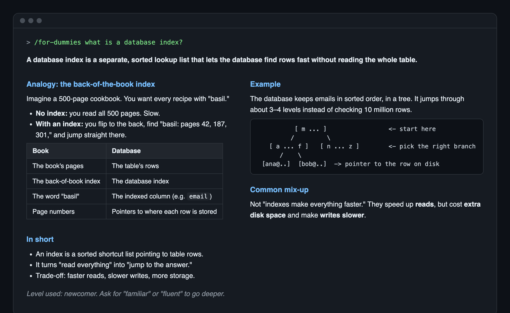

# for-dummies

A skill for Claude Code (and other agent-skill tools) that explains anything clearly: concepts, code, errors, systems.



Every answer has the same shape: **one-sentence answer, analogy, concrete example, diagram, common mix-up, recap.**

## Try it

```
/for-dummies what is a database index?
/for-dummies this stack trace
/for-dummies Rust ownership familiar
/for-dummies Raft leader election fluent
/for-dummies
```

The last one, with no topic, explains whatever was just discussed. Follow up with `simpler` or `deeper` to move a level.

Plain phrases also trigger it: "ELI5", "in simple terms", "I don't get it". If you installed it as a plugin, the command is `/for-dummies:for-dummies`.

## What you get

Real, unedited answers from the skill:

- [What is a database index?](examples/database-index.md): analogy, mapping table, ASCII tree (terminal output)
- [How does "log in with Google" work?](examples/log-in-with-google.md): end-to-end walk-through with a sequence diagram

## Features
- **Three levels:** `newcomer` (default, zero background), `familiar` (you know the basics or a neighbouring field), `fluent` (internals, edge cases, trade-offs). Picked from how you ask; never asks you.
- **A diagram that fits the topic:** flowchart, sequence diagram, table or chart. Mermaid where it renders, ASCII in a terminal.
- **End-to-end examples** for multi-step workflows: one input followed from start to finish.
- **Your code, not a generic version**, when you point at something in your project.
- **The common mix-up** at your level, in one line.
- **Follow-ups:** "simpler" gets a different analogy, not the same one again.

## Install

**Claude Code plugin**
```
/plugin marketplace add omeramar4/for-dummies
/plugin install for-dummies@for-dummies
```

**Any skills-compatible agent**
```
npx skills add omeramar4/for-dummies
```

**Manual**
```
git clone https://github.com/omeramar4/for-dummies && cp -r for-dummies/skills/for-dummies ~/.claude/skills/
```

## Contributing
Open an issue with a topic where the explanation missed. The best fixes are one-line rule changes in `skills/for-dummies/SKILL.md`.

## License
MIT
