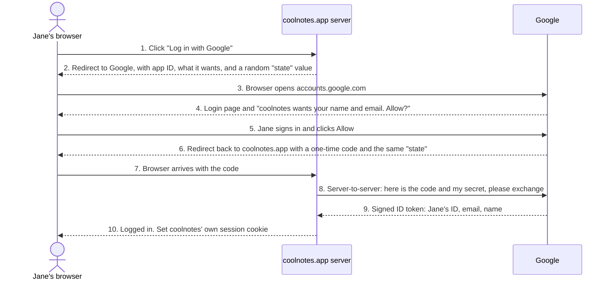

Unedited output of `/for-dummies how does "log in with Google" work, end to end?`, written for GitHub so the diagram is Mermaid.

---

# How "Log in with Google" works, end to end

**Short answer:** the app sends you to Google, Google checks who you are, and then Google hands the app a signed note saying "this is Jane, I vouch for her." The app trusts the note and starts its own session for you. The app never sees your Google password.

(The standard behind this is called **OAuth 2.0 + OpenID Connect**, "OIDC". OAuth is the handoff mechanism. OIDC is the part that says *who you are*.)

## Analogy: the club and the government office

You want into a club (the **app**). The club doesn't keep its own list of members. Instead it says: "Go to the government office across the street (**Google**), get proven, and bring back a **sealed, stamped letter**."

| Real life | Login |
|---|---|
| You | The user (and their browser) |
| The club | The app you want to log in to |
| The government office | Google |
| The sealed, stamped letter | The **ID token**: a signed statement of who you are |
| The stamp that can't be faked | A cryptographic signature only Google can make |
| The wristband the club gives you after | The app's own **session cookie** |

Where it breaks: in real life you carry the letter yourself. Here, the club's *back office* (the app's server) collects it directly from Google, so you can't tamper with it on the way.

## One concrete walk-through

Jane opens `coolnotes.app` and clicks **Log in with Google**.

In words:

1. **Click.** The button is just a link to Google.
2. **Redirect to Google.** The URL looks like `accounts.google.com/o/oauth2/v2/auth?client_id=...&redirect_uri=https://coolnotes.app/callback&scope=openid email profile&state=abc123`. It says *who is asking* (`client_id`), *where to send Jane back* (`redirect_uri`), *what it wants* (`scope`), and a random `state`.
3. **Google handles login.** Jane types her password (and 2FA) **on Google's site**. Coolnotes never sees it.
4. **Consent.** Google shows what coolnotes is asking for. Jane allows.
5. **Redirect back with a code.** Google sends the browser to `https://coolnotes.app/callback?code=XYZ&state=abc123`. The `code` is a short-lived, single-use claim ticket, *not* proof of identity yet.
6. **App checks `state`.** It must match what the app sent in step 2. This blocks forged callbacks.
7. **Code exchange (the key step).** The app's *server* calls Google directly, sending the `code` plus its **client secret** (a password only the app and Google know). Because this happens server to server, Jane's browser can't see or fake it.
8. **ID token comes back.** It's a signed blob (a JWT) containing, roughly: `sub` (Jane's permanent Google user ID), `email`, `name`, `aud` (which app it's for), `exp` (expiry).
9. **App verifies the token.** It checks Google's signature using Google's public keys, that `aud` is its own `client_id`, that it hasn't expired, and that `iss` is Google.
10. **App creates its own session.** It finds or creates Jane's account (keyed on `sub`), then sets a cookie. From now on Jane is "logged in" the same way as with any password login.

## Common mix-ups

- **Not:** "Google keeps me logged in to the app." **Actually:** after step 10, the app uses *its own* cookie. Google isn't involved on later page loads.
- **Not:** "The app gets my Google password." **Actually:** it only gets the token and whatever scopes you approved.
- **Not:** "The code in the URL is the login." **Actually:** it's useless until the server swaps it, with its secret, for the token.
- **Tip for builders:** identify users by `sub`, not `email`. Emails can change; `sub` never does.

## Why it matters

Building safe password login is hard: storing hashes, resets, breach handling, 2FA. This lets the app hand all of that to a company that does it well, and lets you skip yet another password.

## In short

- The app **redirects** you to Google; Google **authenticates** you and redirects back with a one-time **code**.
- The app's server **trades the code for a signed ID token**, verifies it, and learns who you are.
- The app then sets **its own session cookie**; Google's job is done.

## Check yourself

Why does the app exchange the code on its *server* instead of just trusting the code in the browser URL?

*Answer:* The URL passes through the user's browser, where it can be seen or tampered with. The exchange needs the client secret, which only the server has, so only the real app can turn the code into a token.

---
*Level: newcomer. Ask for "familiar" or "fluent" to go deeper (PKCE, nonce, refresh tokens, token validation details).*
