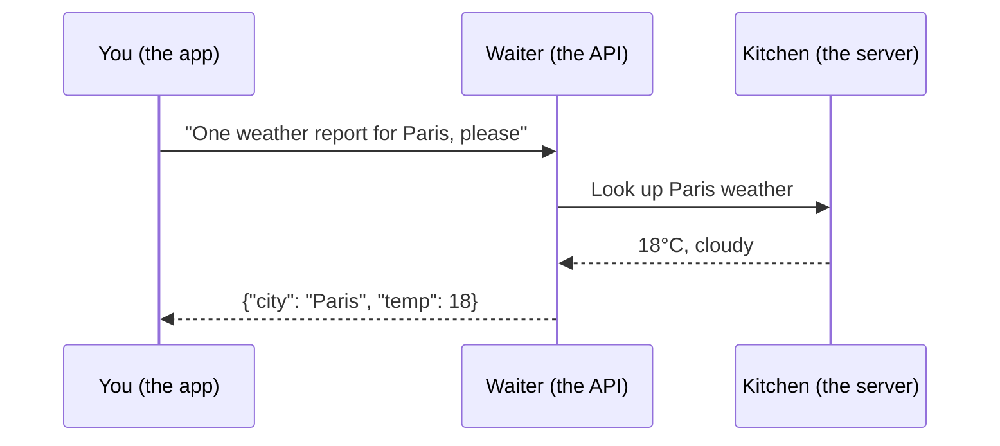

# Example: `/for-dummies what is an API?`

**An API is a menu that lets one program ask another program to do something, without knowing how it works inside.**

**Analogy: a restaurant.** You (the app) don't walk into the kitchen. You read the menu (the API's list of allowed requests), tell the waiter (the API) what you want, and the kitchen (the server) cooks it. You get a plate back (the response).

**Example.** A weather app asks `GET /weather?city=Paris`. The reply is a small bundle of data, `{"city": "Paris", "temp": 18}`. The app never sees the weather company's database.

**Common mix-up.** Not "an API is a website". It's a doorway for programs; a website is a doorway for people.

**Why it matters.** Apps can borrow features (maps, payments, weather) instead of rebuilding them.

**In short**
- An API = a menu of requests a program is allowed to make.
- You ask, it answers; the inside stays hidden.

**Check yourself:** In the restaurant story, what is the "menu"? *(The list of requests the API accepts.)*

*Level: newcomer. Say "deeper" for more detail.*
